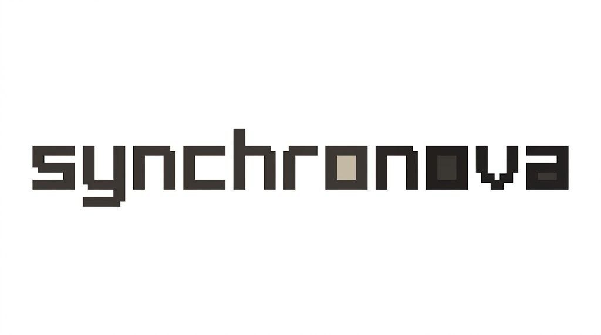
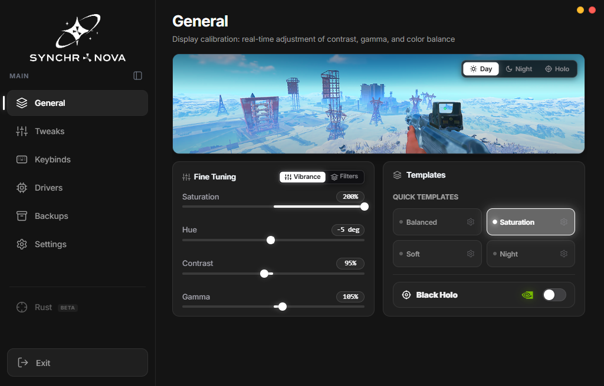

<p align="center">
  <a href="https://github.com/Arean-Max/synchro-nova">
    <picture>
      <source srcset="docs/logo-dark.png" media="(prefers-color-scheme: dark)">
      <source srcset="docs/logo-light.png" media="(prefers-color-scheme: light)">
      
    </picture>
  </a>
</p>

<p align="center">Ein schlankes Windows-Tool für Monitor-Farbsättigung und Latenz-Optimierung.</p>

<p align="center">
  <a href="https://t.me/synchronova"></a>
  <a href="https://deepwiki.com/Arean-Max/synchro-nova"></a>
  <a href="https://gitdiagram.com/arean-max/synchro-nova"></a>
  <a href="https://github.com/Arean-Max/synchro-nova/releases"></a>
  <a href="LICENSE"></a>
  <a href="https://microsoft.com/windows"></a>
</p>

<p align="center">
  <a href="README.md">English</a> |
  <a href="README.zh.md">简体中文</a> |
  <a href="README.zht.md">繁體中文</a> |
  <a href="README.ko.md">한국어</a> |
  <a href="README.de.md">Deutsch</a> |
  <a href="README.es.md">Español</a> |
  <a href="README.fr.md">Français</a> |
  <a href="README.it.md">Italiano</a> |
  <a href="README.da.md">Dansk</a> |
  <a href="README.ja.md">日本語</a> |
  <a href="README.pl.md">Polski</a> |
  <a href="README.ru.md">Русский</a> |
  <a href="README.bs.md">Bosanski</a> |
  <a href="README.ar.md">العربية</a> |
  <a href="README.no.md">Norsk</a> |
  <a href="README.br.md">Português (Brasil)</a> |
  <a href="README.th.md">ไทย</a> |
  <a href="README.tr.md">Türkçe</a> |
  <a href="README.uk.md">Українська</a> |
  <a href="README.bn.md">বাংলা</a> |
  <a href="README.gr.md">Ελληνικά</a> |
  <a href="README.vi.md">Tiếng Việt</a>
</p>

[](https://github.com/Arean-Max/synchro-nova/releases)

---

### Warum ich das gebaut habe

Jedes Mal, wenn ich CS2 oder Apex startete, musste ich die NVIDIA-Systemsteuerung öffnen, Digital Vibrance aufdrehen, um Feinde in dunklen Ecken zu erkennen, und es dann nach dem Schließen des Spiels manuell wieder herunterdrehen, damit mein Desktop und mein Browser meine Netzhaut nicht verbrannten.

Synchro löst dieses Problem ein für alle Mal:
- **Automatischer Farbwechsel**: Starten Sie Ihr Spiel, die Farben treten in Erscheinung. Alt-Tab oder schließen Sie das Spiel, die Farben Ihres Desktops kehren sofort wieder zur Normalität zurück.
- **Latenzbereinigung**: Beendet die Windows-Mausbeschleunigung, optimiert die Timer-Auflösung und reduziert die Pufferung von Netzwerkpaketen, sodass sich die Eingabe sofort anfühlt.
- **Keine Blähungen**: Der Download mit weniger als 5 MB startet in Millisekunden und bleibt mit ca. 2 MB RAM still in der Schublade.

> [!TIP]
> **Getestete Vibrance-Voreinstellungen für beliebte Spiele:**
> - **CS2 (Dust II, Mirage, Inferno)**: Auf „150–165 %“ eingestellt. Spielermodelle verschmelzen nicht mehr mit Wänden und Kisten.
> - **Valorant**: Etwa „135–140 %“ ist ausreichend. Das Spiel verfügt bereits über feindliche Umrisse; Höhere Werte verwaschen nur die Farben.
> - **Apex Legends & Rust**: „160–170 %“ wirkt Wunder beim Erkennen von Silhouetten in Büschen und auf große Entfernungen.
> - **Zwei Monitore**: Vibrance gilt nur für den primären Monitor, auf dem Ihr Spiel läuft. Ihr zweiter Bildschirm mit Discord oder Chrome behält die normalen Farben bei.

---

### Herunterladen und Ausführen (Einsteigerhandbuch)

Wenn Sie neu bei GitHub sind, finden Sie hier den gesamten Prozess:

1. Klicken Sie rechts auf dieser Seite auf [**Releases**](https://github.com/Arean-Max/synchro-nova/releases).
2. Laden Sie **`synchro.exe`** herunter – es ist die portable Version. Speichern Sie es an einem beliebigen Ort und doppelklicken Sie zum Starten, es ist kein Installationsprogramm erforderlich. (Oder greifen Sie zu „Synchro.Nova_*_x64-setup.exe“, wenn Sie Startmenü-Verknüpfungen wünschen.)
3. **Wenn Windows ein blaues SmartScreen-Popup anzeigt („Windows hat Ihren PC geschützt“)**:
   - Mach dir keine Sorge. Windows zeigt dies für jedes kostenlose Indie-Programm an, das keine Unternehmenssignatur für 500 US-Dollar pro Jahr von Microsoft kauft.
   - Klicken Sie auf **„Weitere Informationen“** ➔ **„Trotzdem ausführen“**.
   - Das Projekt ist hier zu 100 % Open Source. Keine Telemetrie, keine Miner, keine Werbung.

---

### Schnellstart: 3 einfache Schritte

1. Starten Sie „synchro.exe“.
2. Wählen Sie unter der Registerkarte **„Farbe“** Ihre Lebendigkeitsstufe aus (z. B. „150 %“).
3. Wählen Sie Ihr Spiel aus der Liste aus (oder zeigen Sie auf seine „.exe“-Datei).
Auf das Tablett legen und spielen. Sie müssen es nie wieder manuell anpassen.

---

### FAQ

#### Werde ich in CS2, Valorant, Rust oder Faceit gesperrt?
**100 % Nein. Das Ban-Risiko ist Null.**  
Synchro Nova **Berührt den Spiel-RAM nicht, fügt keine DLLs in Prozesse ein und zeichnet keine Overlays**. Es passt den Gammawert ausschließlich über Standard-Windows-Anzeige-APIs an – genau wie das Ziehen des Schiebereglers in der NVIDIA- oder AMD-Systemsteuerung. Anti-Cheat-Systeme (VAC, Faceit, Vanguard, EAC, BattlEye) betrachten es nicht einmal als Spielinteraktion.

#### Warum dies über die NVIDIA/AMD-Systemsteuerung verwenden?
GPU-Kontrollfelder können die Einstellungen pro Spiel nicht automatisch umschalten. Wenn Sie dort die Vibration erhöhen, bleibt Ihr gesamter Desktop beim Surfen oder Ansehen von Videos überlastet. Synchro erledigt dies automatisch im laufenden Betrieb.

#### Sind die Windows-Optimierungen sicher?
Ja. Wir beeinträchtigen die Kernintegrität des Betriebssystems nicht, beschädigen Windows Defender nicht und deaktivieren Ihre Auslagerungsdatei nicht. Bevor Sie eine Einstellung vornehmen, erstellt Synchro einen Windows-Wiederherstellungspunkt und eine Sicherung der Registrierung. Wenn Ihnen eine Änderung nicht gefällt, können Sie durch Klicken auf **„Änderungen rückgängig machen“** alles sofort zurücksetzen.

---

### Dokumentation & Deep Dive

Ausführliche technische Details finden Sie in unseren speziellen Ressourcen:
- 📖 [Vollständige interaktive Dokumentation auf DeepWiki](https://deepwiki.com/Arean-Max/synchro-nova)
- 🗺️ [Architekturdiagramm auf GitDiagram](https://gitdiagram.com/arean-max/synchro-nova)
- 📋 [Vollständige Referenz zu Optimierungen und Registrierung (TWEAKS_REFERENCE.de.md)](docs/TWEAKS_REFERENCE.de.md)

---

### Aus dem Quellcode erstellen (für Entwickler)

```bash
git clone https://github.com/Arean-Max/synchro-nova.git
cd synchro-nova
npm install
npm run dev       # Entwicklungsmodus
npm run build     # Release-Build
```

---

### Mitwirkende

- [sotoykor-source](https://github.com/sotoykor-source) — Ursprünglicher Ersteller und Upstream-Autor
- [Arean-Max](https://github.com/Arean-Max) — Entwicklung & Wartung

---

### Lizenz

[MIT](LICENSE) — Die Nutzung, Änderung und Weitergabe ist kostenlos.
