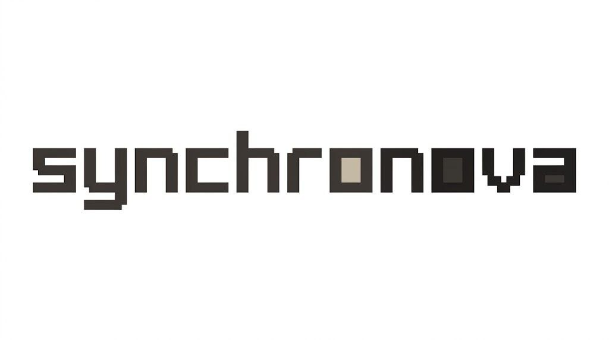
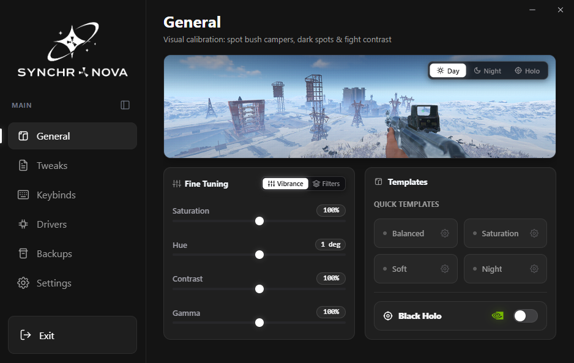

<p align="center">
  <a href="https://github.com/Arean-Max/synchro-nova">
    <picture>
      <source srcset="docs/logo-dark.png" media="(prefers-color-scheme: dark)">
      <source srcset="docs/logo-light.png" media="(prefers-color-scheme: light)">
      
    </picture>
  </a>
</p>

<p align="center">Herramienta ligera para saturación de color del monitor y optimización de latencia en Windows.</p>

<p align="center">
  <a href="https://t.me/synchronova"></a>
  <a href="https://github.com/Arean-Max/synchro-nova/releases"></a>
  <a href="LICENSE"></a>
  <a href="https://microsoft.com/windows"></a>
</p>

<p align="center">
  <a href="README.md">English</a> |
  <a href="README.zh.md">简体中文</a> |
  <a href="README.zht.md">繁體中文</a> |
  <a href="README.ko.md">한국어</a> |
  <a href="README.de.md">Deutsch</a> |
  <a href="README.es.md">Español</a> |
  <a href="README.fr.md">Français</a> |
  <a href="README.it.md">Italiano</a> |
  <a href="README.da.md">Dansk</a> |
  <a href="README.ja.md">日本語</a> |
  <a href="README.pl.md">Polski</a> |
  <a href="README.ru.md">Русский</a> |
  <a href="README.bs.md">Bosanski</a> |
  <a href="README.ar.md">العربية</a> |
  <a href="README.no.md">Norsk</a> |
  <a href="README.br.md">Português (Brasil)</a> |
  <a href="README.th.md">ไทย</a> |
  <a href="README.tr.md">Türkçe</a> |
  <a href="README.uk.md">Українська</a> |
  <a href="README.bn.md">বাংলা</a> |
  <a href="README.gr.md">Ελληνικά</a> |
  <a href="README.vi.md">Tiếng Việt</a>
</p>

[](https://github.com/Arean-Max/synchro-nova/releases)

---

### Instalación

Descarga la última versión en [**Releases**](https://github.com/Arean-Max/synchro-nova/releases):

- **Versión Portable (`Synchro-Nova-*-Portable.zip`)** — Descomprime y ejecuta `synchro.exe`. No requiere instalación.
- **Instalador (`Synchro.Nova_*_x64-setup.exe`)** — Instalador estándar con accesos directos y desinstalador.

---

### Preguntas frecuentes (FAQ)

#### ¿Qué es esta herramienta?
Una utilidad ligera para jugadores. Hace que los colores en juegos competitivos sean más vivos, mejora la visibilidad de los rivales y elimina la latencia innecesaria de Windows. Cambia de perfil automáticamente al abrir el juego.

#### ¿Me pueden banear?
No. Synchro Nova no toca la memoria de los juegos, no inyecta DLLs ni usa superposiciones. Ajusta los colores mediante las APIs estándar de Windows, igual que los paneles de NVIDIA o AMD. Seguro al 100% en VAC, Faceit, Vanguard, EAC y BattlEye.

#### ¿Por qué es mejor que VibranceGUI o los paneles de GPU?
Desarrollada en Rust + Tauri: inicio instantáneo, consume 0% de CPU y solo ~4 MB de RAM en la bandeja del sistema. Incluye perfiles automáticos por juego y optimización segura de latencia.

#### ¿Los ajustes dañarán mi Windows?
No. Solo aplica configuraciones comprobadas. Antes de cualquier cambio crea automáticamente un punto de restauración del sistema y una copia del registro.

---

### Compilar desde el código fuente

```bash
git clone https://github.com/Arean-Max/synchro-nova.git
cd synchro-nova
npm install
npm run dev       # ejecutar en modo desarrollo
npm run build     # compilar instalador final
```

---

### Licencia

[AGPL-3.0](LICENSE)

---

### Documentation & Architecture

